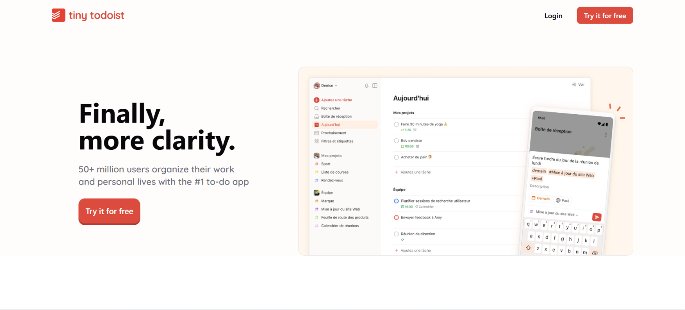
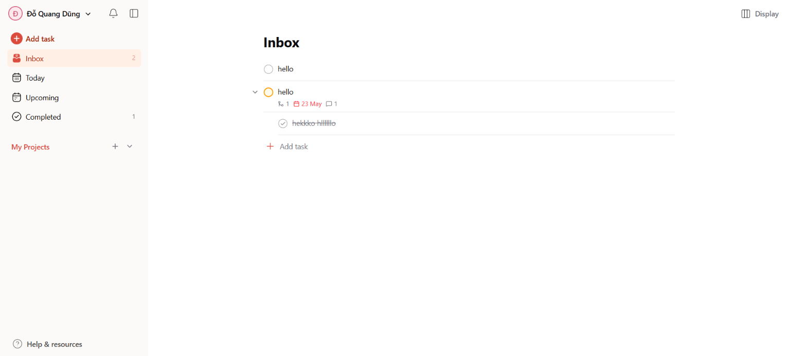
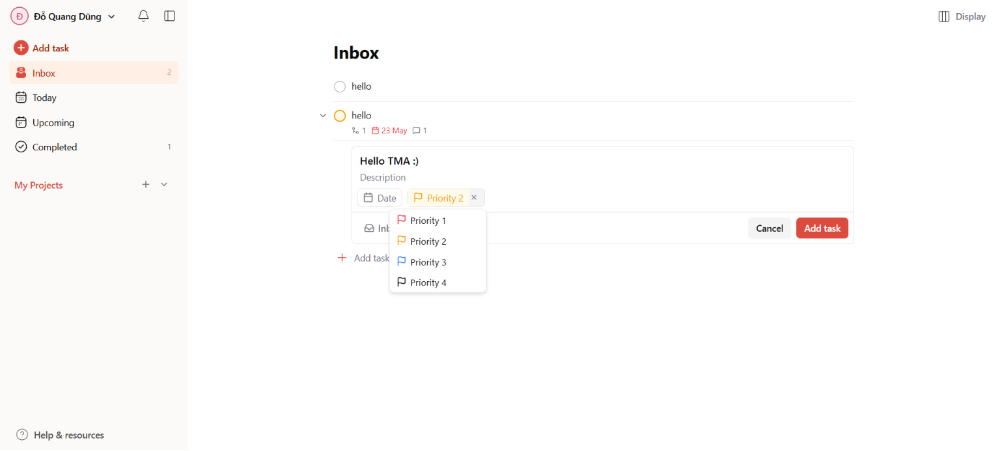
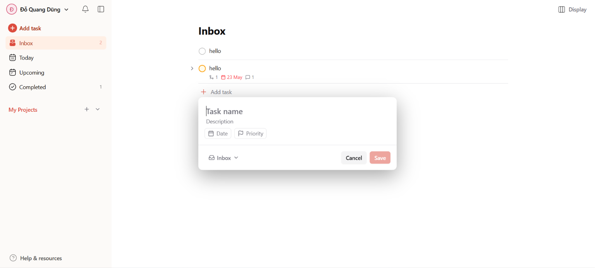

# Tiny Todoist

Tiny Todoist is a full-stack task-management application inspired by Todoist. It provides a focused workspace for planning tasks, organizing them into projects, setting priorities and due dates, and tracking work from Inbox through completion.

> This is an independent educational project and is not affiliated with Todoist.

**Live demo:** [tiny-todoist.vercel.app](https://tiny-todoist.vercel.app/)

## Preview

<p align="center">
  
</p>

<p align="center">
  
</p>

<p align="center">
  
</p>

<p align="center">
  
</p>

## Features

- Email/password authentication and GitHub OAuth sign-in.
- Email verification for new accounts.
- Create, edit, complete, and delete tasks.
- Add descriptions, priorities, due dates, comments, and file attachments.
- Organize tasks in projects and create nested subtasks.
- Browse dedicated Inbox, Today, Upcoming, Completed, and project views.
- Manage the user profile, including display name and avatar.
- Responsive interface for desktop and mobile use.

## Technology

| Area | Technologies |
| --- | --- |
| Frontend | React 19, TypeScript, Vite, React Router |
| UI and styling | Tailwind CSS, Radix UI, shadcn/ui, Framer Motion, Lucide |
| Client data | TanStack Query, Zustand, Axios, React Hook Form, Zod |
| Backend | Node.js, Express 5, TypeScript |
| Database | PostgreSQL, Prisma ORM |
| Authentication | JWT, Passport, GitHub OAuth, bcryptjs |
| Storage and email | Supabase Storage, Multer, Nodemailer |
| Operational tooling | Helmet, CORS, express-rate-limit, Winston |

## Project Structure

```text
tiny-todoist/
├── client/                         # React single-page application
│   ├── public/                     # Static assets
│   └── src/
│       ├── assets/                 # Images and visual assets
│       ├── components/             # Reusable UI and feature components
│       │   ├── ui/                 # Base UI primitives
│       │   ├── SettingsDialog/     # Account settings UI
│       │   └── TaskDetailDialog/   # Task details, comments, and subtasks
│       ├── hooks/                  # Query and UI hooks
│       ├── layouts/                # Authentication and application layouts
│       ├── pages/                  # Route-level views
│       ├── routes/                 # Routing and access guards
│       ├── services/               # API client functions
│       ├── stores/                 # Zustand state stores
│       ├── types/                  # Shared TypeScript types
│       └── utils/                  # Client-side helpers
├── server/                         # Express API
│   ├── prisma/                     # Prisma schema and migrations
│   └── src/
│       ├── config/                 # Environment and Passport setup
│       ├── controllers/            # HTTP request handlers
│       ├── middlewares/            # Authentication, validation, upload, errors
│       ├── routes/                 # API route definitions
│       ├── services/               # Business logic and data operations
│       ├── validations/            # Zod request schemas
│       ├── lib/                    # Prisma, Supabase, JWT, logging utilities
│       └── seeds/                  # Sample data
├── docs/screenshots/               # README screenshots
├── LICENSE
└── README.md
```

## Getting Started

### Prerequisites

- Node.js 18 or later
- npm
- PostgreSQL (or Docker to run PostgreSQL locally)
- A Supabase project for file storage (optional for development without uploads)
- GitHub OAuth credentials (optional if GitHub sign-in is not required)

### 1. Clone the repository

```bash
git clone https://github.com/your-username/tiny-todoist.git
cd tiny-todoist
```

### 2. Configure and run the API

```bash
cd server
npm install
cp .env.example .env
```

Start PostgreSQL locally, for example with Docker:

```bash
docker run --name tiny-todoist-db -e POSTGRES_PASSWORD=mysecretpassword -p 5432:5432 -d postgres
```

Update `server/.env` with the required database, JWT, email, Supabase, and OAuth settings. Then apply migrations and start the API:

```bash
npx prisma migrate dev
npm run dev
```

The API runs at `http://localhost:3000` by default.

### 3. Configure and run the client

Open another terminal from the project root:

```bash
cd client
npm install
cp .env.example .env
```

Set the API endpoint in `client/.env`:

```env
VITE_API_BASE_URL=http://localhost:3000/api/v1
```

Start the development server:

```bash
npm run dev
```

Open `http://localhost:5173` in your browser.

## Available Scripts

| Directory | Command | Description |
| --- | --- | --- |
| `client` | `npm run dev` | Start the Vite development server. |
| `client` | `npm run build` | Type-check and create a production build. |
| `client` | `npm run lint` | Run ESLint. |
| `server` | `npm run dev` | Start the API with automatic reload. |
| `server` | `npm run build` | Compile TypeScript for production. |
| `server` | `npm start` | Run the compiled server. |
| `server` | `npm run lint` | Run ESLint on TypeScript files. |

## License

This project is licensed under the [MIT License](LICENSE).
